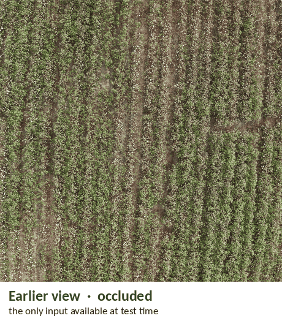
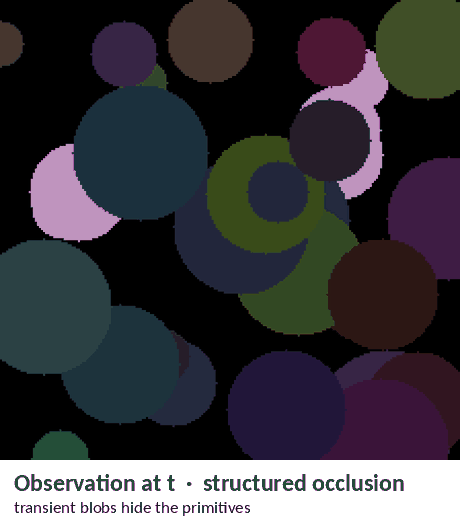
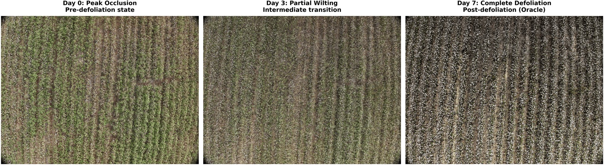
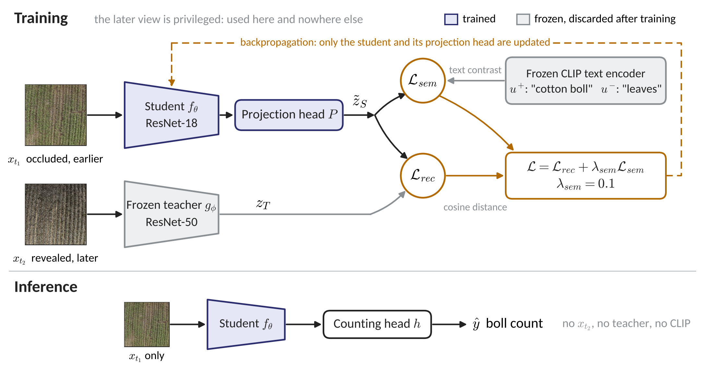
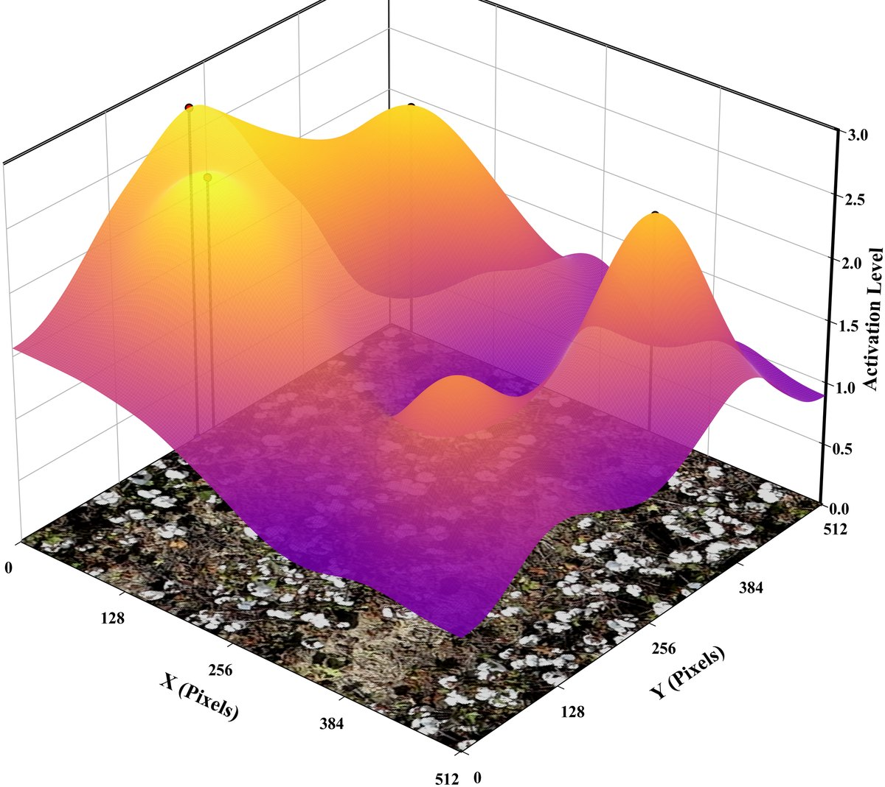
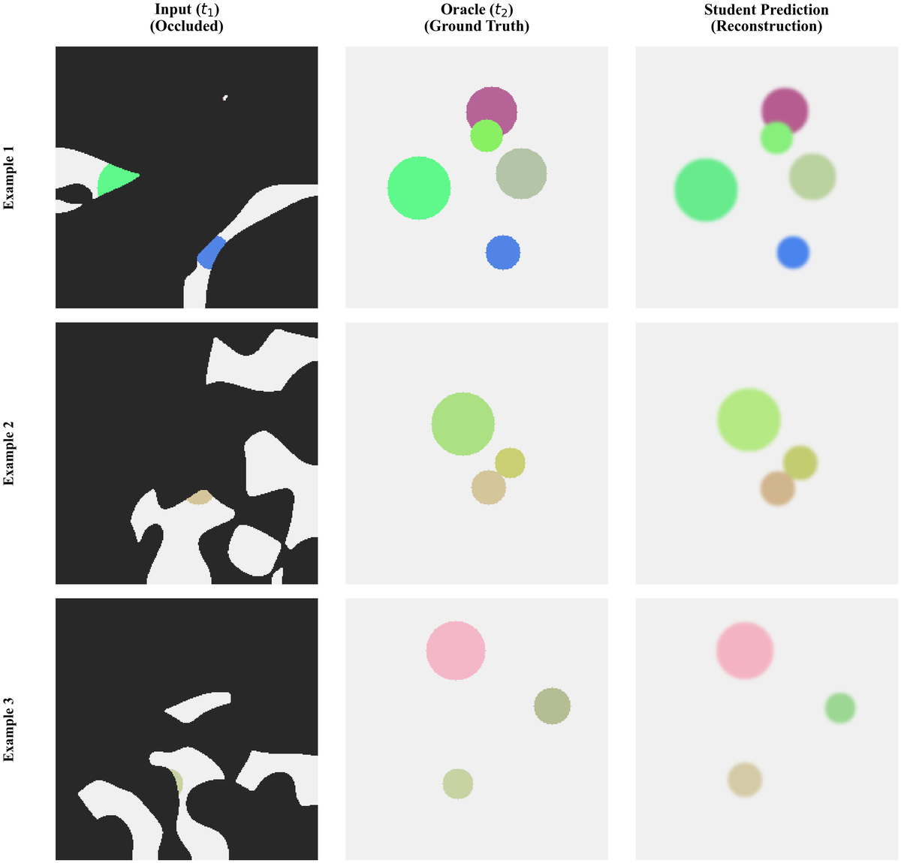
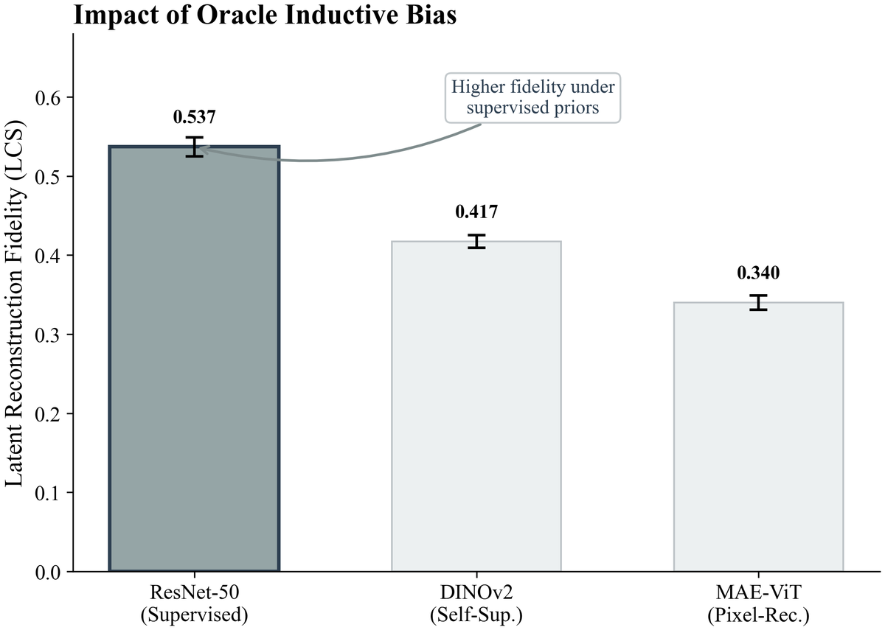
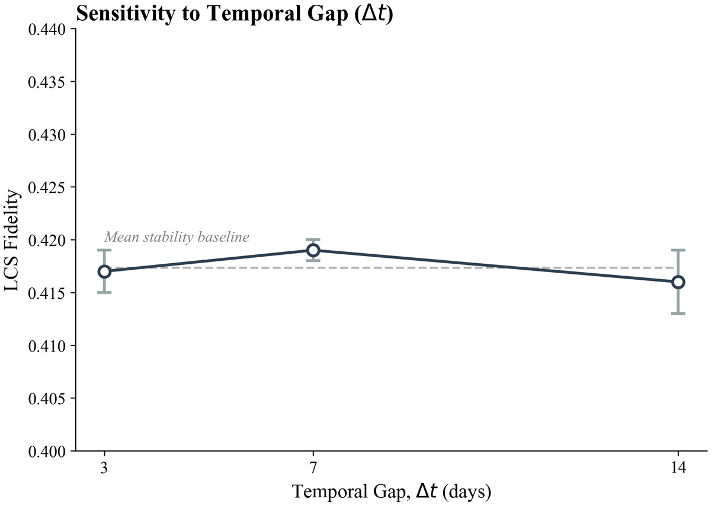

<h1 align="center">Learning Object Permanence from Natural Revealing Events</h1>
<h3 align="center">Temporal privileged distillation for amodal counting</h3>

<p align="center">
  <b>Harshitha Manjunatha</b><sup>1</sup> · Prabha Sundaravadivel<sup>2</sup> · Shekhar Suman Borah<sup>2</sup> · Lakshman Tamil<sup>1</sup> · H. Allen Torbert<sup>3</sup><br>
  <sup>1</sup>The University of Texas at Dallas · <sup>2</sup>The University of Texas at Tyler · <sup>3</sup>USDA Agricultural Research Service
</p>

<p align="center">
  
  
  <a href="https://openreview.net/forum?id=slzb6MtRIj"></a>
  
</p>

<p align="center">
  <a href="https://openreview.net/forum?id=slzb6MtRIj"><b>Paper (OpenReview)</b></a> ·
  <a href="https://harshitha-8.github.io/DEV-AI_2026/"><b>Project page</b></a> ·
  <a href="https://github.com/harshitha-8/WIML_NeurIPS2026"><b>Companion: the method view (WiML)</b></a>
</p>

<p align="center">
  
  &nbsp;&nbsp;
  
</p>

> **Hypothesis.** Stable object representations can be supported by temporally ordered revealing events, provided that object identity is preserved.

---

## The question

An object does not stop existing when something moves in front of it. Infants organize scenes using spatiotemporal continuity and partly visible contours, and they hold expectations about hidden objects before they can describe them [1-3]. Vision models are usually trained on isolated frames instead: they learn to predict an amodal label drawn by a person, or to reconstruct pixels behind an artificial mask. Neither form of supervision uses an ordinary fact about the world, which is that **visibility changes over time**.

This project asks whether that fact alone can supply supervision. Can a model learn what persists by seeing the same scene again once the occluder has gone?

## A natural revealing event

In cotton production, chemical defoliation removes the leaf canopy over several days while mature bolls stay approximately stationary. Time does not merely transform the scene here. It reveals it.

<p align="center"></p>

The later view contains information the earlier view lacks. We treat it as **privileged information**: it shapes the representation during training and is unavailable when predictions are made.

## From a developmental insight to a learning signal

<p align="center"></p>
<p align="center"><i>TePD training and inference. The frozen teacher and the frozen CLIP text encoder shape the student during training and are discarded afterwards.</i></p>

The setting, with targets $S$, structured occluder $N$, an unobserved visibility mask $M$ and residual $\epsilon$:

$$x_{t_1} = M \odot S + (1 - M) \odot N, \qquad x_{t_2} = S + \epsilon$$

A frozen teacher $g_\phi$ encodes the later view; a student $f_\theta$ with projection head $P$ encodes the earlier one:

$$z_T = g_\phi(x_{t_2}), \qquad \tilde z_S = P\big(f_\theta(x_{t_1})\big)$$

$$\mathcal{L}_{rec} = 1 - \frac{\tilde z_S^{\top} z_T}{\lVert \tilde z_S \rVert_2\, \lVert z_T \rVert_2}, \qquad \mathcal{L}_{sem} = -\log \frac{\exp\big(s(\tilde z_S, u^{+})/\tau\big)}{\exp\big(s(\tilde z_S, u^{+})/\tau\big) + \exp\big(s(\tilde z_S, u^{-})/\tau\big)}$$

$$\mathcal{L} = \mathcal{L}_{rec} + \lambda_{sem}\,\mathcal{L}_{sem}, \qquad \lambda_{sem} = 0.1$$

Three design choices carry the developmental idea:

- **Order matters.** The occluder is removed between views, so pixel similarity falls while access to the persistent target improves. The later view is not another augmentation of the earlier one.
- **Representations, not pixels.** A plausible completion can add or remove objects. The student is asked to agree with the features of the particular hidden instance, not to paint a likely one.
- **Asymmetry.** A frozen ResNet-50 teacher and a frozen CLIP guide (prompts "cotton boll" and "leaves") exist only during training. A ResNet-18 student and a counting head run alone afterwards.

## Two falsifiable predictions

The developmental claim is narrow enough to fail:

1. A useful teacher view must reveal the **same underlying instance**.
2. Performance should **deteriorate** as registration error or target motion breaks identity across time.

## Evidence

**Cotton-TePD.** UAV imagery at 30 m above ground, before defoliation and seven days after Thidiazuron application; 512×512 patches registered with SIFT and RANSAC homographies; 2,500 training and 500 test pairs, with test patches drawn from field regions excluded from training.

| Method | Learning signal | LCS ↑ | Counting MAE ↓ |
|---|---|:---:|:---:|
| ResNet-18 | direct supervision | 0.621 | 12.4 |
| DINOv2 | frozen representation | 0.684 | 9.8 |
| Stable Diffusion | generative completion | 0.712 | 8.5 |
| MAE-ViT | masked reconstruction | 0.745 | 7.2 |
| **TePD** | **temporal privilege** | **0.873** | **4.2** |

- Relative to MAE-ViT, the strongest baseline: **+17.2%** LCS and **−41.7%** MAE. Relative to supervised ResNet-18: +40.6% and −66.1%.
- Three disjoint field zones give LCS 0.871 / 0.875 / 0.869 and MAE 4.1 / 4.3 / 4.2.
- The generative baseline beats direct supervision but trails feature distillation, which fits the distinction between a plausible completion and an instance-faithful one.

### What is learned

<p align="center"></p>

Peaks in the student's spatial feature magnitude frequently coincide with boll locations revealed at $t_2$, while some foliage-only regions stay low. This is descriptive evidence about the representation, not proof of causal or human-like reasoning. Removing the semantic term lowers LCS from 0.873 to 0.824 and raises MAE from 4.2 to 5.1. The result is stable for semantic weights from 0.05 to 0.20 and degrades at 1.0 (0.790 / 6.4).

### A controlled synthetic task

<p align="center"></p>

To separate the learning mechanism from crop texture, we built scenes of colored circles hidden by opaque Perlin-noise masks covering 50-80% of the image. The privileged view shows the primitives without the masks. TePD reaches LCS **0.972**; a directly supervised regression baseline reaches **0.640**. The task is deliberately simple, so it tests the mechanism and says nothing about broad cross-domain generalization.

### Teacher choice and temporal gap

<table>
<tr>
<td width="50%"></td>
<td width="50%"></td>
</tr>
<tr>
<td>LCS is teacher-relative, so these values are diagnostic and not a universal scale. In each teacher's own space: ResNet-50 0.537, DINOv2 0.417, MAE-ViT 0.340. The supervised teacher is the more learnable target in this domain.</td>
<td>Gaps of 3, 7 and 14 days give mean LCS 0.417, 0.419 and 0.416. Similarity is stable within the tested interval. Longer gaps, storms, target motion or growth may break the correspondence assumption.</td>
</tr>
</table>

## A developmental reading

The order and structure of experience supply supervision that neither frame holds alone. An ambiguous observation is constrained after the fact by a later encounter with the same scene. That asymmetry resembles a developmental curriculum, and it may be useful wherever visibility changes while identity persists: snow melt, tidal recession, staged assembly, repeated robot interaction. Each of those would need evidence that the later view preserves the target instance.

## Why this matters beyond one dataset

The claim is about learning, not about cotton. Three ideas carry over to other problems:

- **Experience is ordered, and the order is informative.** Standard self-supervision treats two views of a scene as interchangeable. A revealing event makes one view strictly more informative than the other, and that asymmetry is a usable training signal.
- **Supervision can come from the world's own dynamics.** No person completes the hidden object; a later look at the same scene does. Any system that revisits scenes collects such pairs as a by-product of operating.
- **What is learned outlives the teacher.** The privileged view shapes the representation and is then removed. The student acts on the occluded present alone, with a ResNet-18 forward pass and a counting head.

The boundary is equally general: the later view must show the same instances. Where identity is not preserved, the signal is noise.

## What this is not

- It is not a psychological model. It does not simulate gaze, action, memory consolidation or an infant's curriculum.
- It assumes approximate target stationarity, a monotonic increase in visibility and adequate registration. Wind, shadows, growth, fallen bolls or non-planar parallax can make teacher and student describe different physical evidence.
- The evidence covers one crop, one acquisition protocol, one revealing intervention and one synthetic control.

## Open questions

- Does the effect hold in richer environments and under active viewpoints?
- What happens with genuinely developmental curricula, where revealing events arrive in a structured order?
- How does performance fall as a function of measured registration error?

## At NeurIPS 2026

| | |
|---|---|
| Event | DevAI: Developmental Perspectives on AI, NeurIPS 2026 Workshop |
| Where | Georgia World Congress Center, Atlanta, GA, Room C108-C109 |
| When | Sunday, December 13, 2026 (confirm session times on the NeurIPS schedule) |

## Repository

```
docs/            project page (served by GitHub Pages)
docs/assets/     figures and animations
```

This repository currently hosts the project page and figures. Code and the Cotton-TePD data are not included here yet.

## Paper

Accepted paper and reviews on OpenReview: https://openreview.net/forum?id=slzb6MtRIj

## Citation

```bibtex
@inproceedings{manjunatha2026permanence,
  title     = {Learning Object Permanence from Natural Revealing Events: Temporal Privileged Distillation for Amodal Counting},
  author    = {Manjunatha, Harshitha and Sundaravadivel, Prabha and Borah, Shekhar Suman and Tamil, Lakshman and Torbert, H. Allen},
  booktitle = {NeurIPS 2026 Workshop on Developmental Perspectives on AI (DevAI)},
  year      = {2026}
}
```

## References

1. P. J. Kellman and E. S. Spelke. Perception of partly occluded objects in infancy. *Cognitive Psychology*, 1983.
2. E. S. Spelke. Principles of object perception. *Cognitive Science*, 1990.
3. R. Baillargeon. Object permanence in 3.5- and 4.5-month-old infants. *Developmental Psychology*, 1987.
4. V. Vapnik and A. Vashist. A new learning paradigm: Learning using privileged information. *Neural Networks*, 2009.
5. D. Lopez-Paz, L. Bottou, B. Schölkopf and V. Vapnik. Unifying distillation and privileged information. *ICLR*, 2016.

## Acknowledgments and contact

This work was funded by USDA-ARS NACA: 58-6010-4-007. The views expressed are those of the authors and do not necessarily reflect USDA-ARS.

Contact: harshitha.manjunatha@utdallas.edu

The same study is presented with a method and benchmark focus at the WiML workshop: [TePD: Temporal Privileged Distillation](https://github.com/harshitha-8/WIML_NeurIPS2026).
